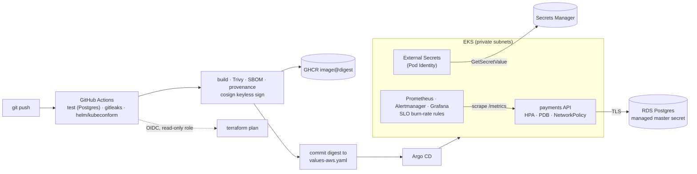
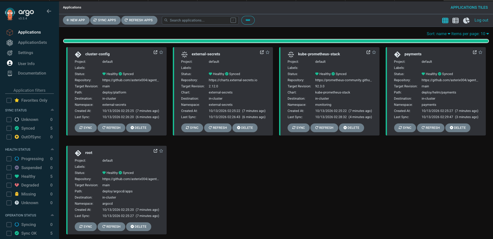
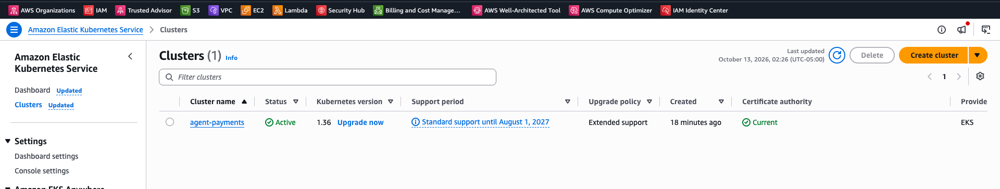
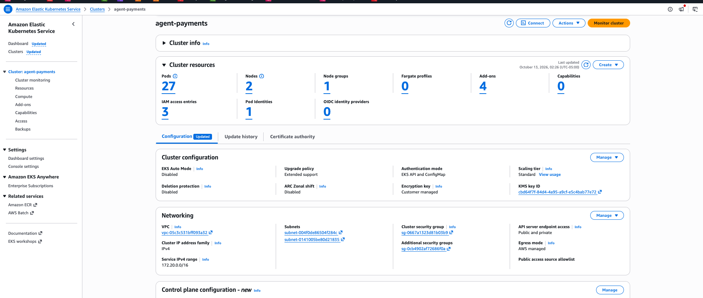
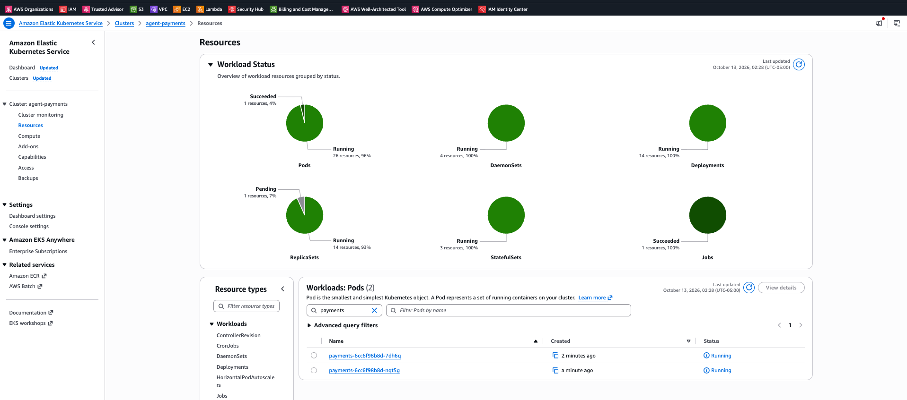
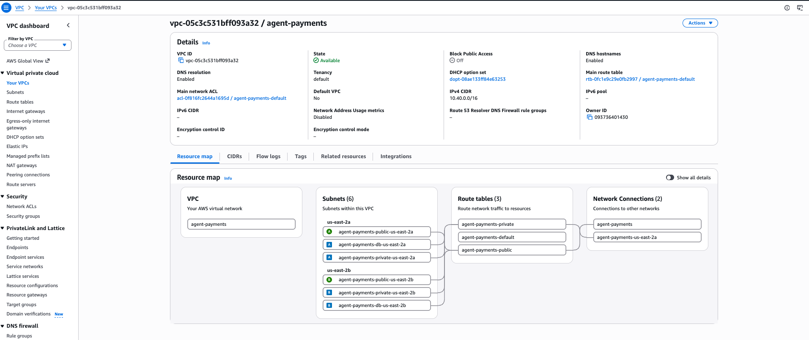
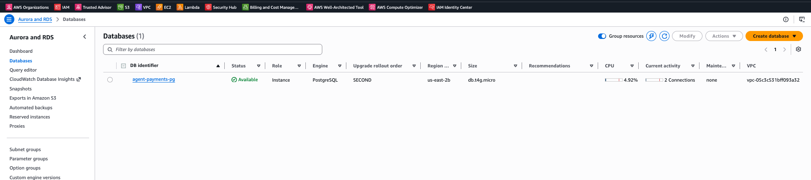
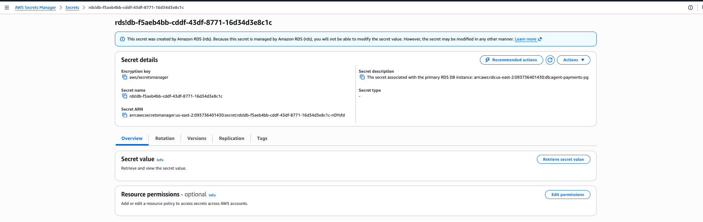
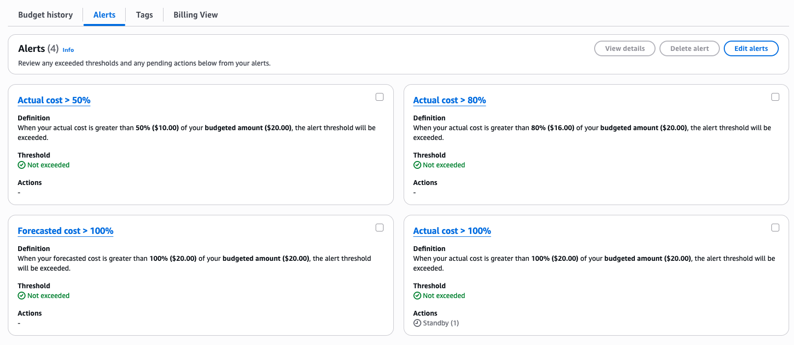

# Agent Payments Platform

A reference platform for an **AI-agent payments API**: agents prove who they are with signed *Know Your Agent* (KYA) tokens, move money through an **idempotent, double-entry ledger**, and the service ships through a **GitOps pipeline with a signed, scanned supply chain** onto **EKS**, with **SLO burn-rate alerting** and a runbook for every page.

The goal is the platform around a payments service, built the way a regulated fintech would expect: no long-lived credentials anywhere, every deploy traceable to a commit and an image digest, and failure modes rehearsed, not hoped about.



## What it demonstrates

| Concern | How |
|---|---|
| **Money correctness** | Integer minor units only; double-entry ledger where every transaction's rows sum to zero; account rows locked in a stable order so concurrent payments cannot overdraw or deadlock |
| **Exactly-once payments** | `Idempotency-Key` required; key, request hash and response stored in the *same* DB transaction as the ledger rows; retries replay the original response, and a reused key with a different body is rejected |
| **Agent identity** | ES256/RS256 JWTs from a KYA issuer; the API holds only the public key; scopes and a per-payment spend cap come from the token |
| **No static credentials** | GitHub → AWS via OIDC (read-only plan role); pods → Secrets Manager via EKS Pod Identity; RDS password generated and rotated by AWS, never in Terraform state |
| **Supply chain** | Trivy gate on fixable HIGH/CRITICAL, SPDX SBOM, build provenance, keyless cosign signature, deploy by immutable digest |
| **GitOps** | Argo CD app-of-apps with sync waves (operators → cluster config → workloads); CI promotes by committing the digest |
| **Reliability** | 99.9% availability and 99% < 250 ms SLOs; multi-window multi-burn-rate alerts; runbook link on every alert; HPA, PDB, zone spread, read-only root FS, non-root, dropped capabilities |
| **Rehearsed failure** | `make chaos` takes the database away under load and walks through detection and recovery |

## Run it locally (kind, no cloud cost)

Prerequisites: Docker, `kind`, `kubectl`, `helm`, Python 3.12.

```bash
make venv && make test          # 19 API tests on SQLite
make local-up                   # kind + Prometheus/Grafana + Postgres + payments (2 replicas)
make port-forward               # terminal 1: http://localhost:8080/docs
make loadgen RPS=20             # terminal 2: steady agent traffic
make grafana                    # terminal 3: dashboards
make chaos                      # terminal 4: database outage drill
make local-down
```

Race-condition tests need real row locks: `TEST_DATABASE_URL=postgresql+psycopg://... make test` (CI always runs them).

## Deploy to AWS

```bash
cp infra/aws/terraform.tfvars.example infra/aws/terraform.tfvars   # your IP, repo, KYA public key
make aws-init && make aws-plan && make aws-up                      # VPC, EKS, RDS, IAM, secrets
make aws-kubeconfig
# put db_endpoint and db_master_secret_arn from `terraform output` into deploy/helm/payments/values-aws.yaml
# replace asterix004 in deploy/argocd/*.yaml, commit, push
make argocd                                                        # Argo CD takes over from Git
make aws-down                                                      # tear down
```

Cost shape (Spot nodes, single NAT, `db.t4g.micro`, no Multi-AZ) and the production deltas are in [ADR 0004](docs/adr/0004-aws-cost-shape.md).

### Deployed and verified on AWS (2026-10-13)

The stack above was applied to a real account in **us-east-2**, verified, and destroyed the same session.

| Step | Result |
|---|---|
| `make aws-up` | 73 resources in ~18 min (EKS cluster 12m40s, RDS 8m, NAT 2m, 2 Spot `t3.large` nodes 2m) |
| `make argocd` | All 5 Argo CD apps **Synced/Healthy** from `main`: `root`, `external-secrets`, `kube-prometheus-stack`, `cluster-config`, `payments` |
| Secrets | External Secrets pulled the RDS master credentials from AWS Secrets Manager (RDS-managed secret, never in Git) |
| Smoke test | `/healthz` and `/readyz` (includes the DB check) **200**. `scripts/loadgen.py` for 30 s: **150/150 payments `201 Created`**, 0 errors |
| GitOps | The commit that pointed `values-aws.yaml` at RDS triggered CI, which signed a new image and committed its digest; Argo CD rolled it out with no manual step |
| `make aws-down` | **74 resources destroyed**. No EKS, EC2, EBS, RDS, NAT, EIP, load balancer, VPC or secret left. ~42 min of uptime, **$0.22** on the bill |















**Spend guardrail.** A $20/month AWS Budget alerts at 50/80/100% actual and 100% forecast. At 100% actual, a budget action automatically attaches a deny-new-workloads service control policy to the account (EC2, NAT, load balancers, RDS and more), so a forgotten environment cannot keep growing. It does not stop what is already running; `make aws-down` does.



**What the first real deploy taught us** (all fixed in `infra/aws`):

- **New AWS accounts can arrive locked down.** Accounts from AWS's 2026 sign-up are "projects" behind AWS-managed service control policies that denied EKS, EC2, RDS and Secrets Manager outright, even read-only calls. Activating the account's advanced features made it a normal AWS Organization. That step is one-way and deletes the built-in spend limit, which is why the budget action above exists.
- **Region is set by policy, not preference.** The remaining AWS-managed SCP allows only global services in us-east-1, so workloads run in **us-east-2** (Terraform default, `ClusterSecretStore`, and the CI plan job).
- **EKS has no metrics API by default.** The payments HPA scales on CPU, so without the `metrics-server` add-on it could not read metrics and Argo CD reported the app Degraded.
- **Pin the EKS version.** With a null version, `terraform-aws-modules/eks` v21 resolves it at apply time and `plan` fails with "Invalid count argument". The upgrade policy is pinned to `STANDARD` too: a cluster left on an old version otherwise moves to extended support at ~6× the control-plane price.
- **NAT data processing was the biggest line on the bill.** The session cost $0.22: NAT gateway $0.14 (of which $0.10 was processing 2.2 GB of image pulls), EKS $0.04, Spot nodes $0.02, RDS $0.01. The images come from GHCR, Quay and Docker Hub, so an ECR VPC endpoint would not help; a pull-through cache in ECR would, for clusters that are recreated often.
- **Declare static RDS parameters as `pending-reboot`.** AWS stores `rds.force_ssl` that way; without saying so, every plan shows a phantom in-place change.

## Verify a deployed image

Every image CI pushes is signed by digest with the workflow's GitHub OIDC identity. Check the digest Argo CD deploys (cosign v3):

```bash
cosign verify "ghcr.io/asterix004/agent-payments-platform@$(yq .image.digest deploy/helm/payments/values-aws.yaml)" \
  --certificate-identity-regexp '^https://github.com/asterix004/agent-payments-platform/.github/workflows/ci.yml@refs/heads/main$' \
  --certificate-oidc-issuer https://token.actions.githubusercontent.com
```

## API

| Method | Path | Scope | Notes |
|---|---|---|---|
| POST | `/v1/accounts` | `accounts:write` | Creates an account owned by the calling agent |
| GET | `/v1/accounts/{id}` | — | Owner only; balance is derived from the ledger |
| POST | `/v1/deposits` | `treasury:deposit` | Sandbox top-up from the treasury account |
| POST | `/v1/payments` | `payments:write` | Requires `Idempotency-Key`; `Idempotent-Replayed: true` on replays |
| GET | `/healthz`, `/readyz`, `/metrics` | — | Readiness checks the database |

## Repository layout

```
app/                    FastAPI service: ledger, KYA auth, metrics, optional OpenTelemetry
tests/                  API, idempotency, auth and Postgres race-condition tests
deploy/helm/payments/   Chart: Deployment, HPA, PDB, NetworkPolicy, ServiceMonitor, SLO rules, ExternalSecret
deploy/argocd/          App-of-apps and platform applications
deploy/platform/        ClusterSecretStore
infra/aws/              Terraform: VPC, EKS (v21 module), RDS, Pod Identity, GitHub OIDC
local/                  kind config, local Postgres, Prometheus values
scripts/                Dev KYA issuer, load generator, chaos drill
docs/                   ADRs, SLOs, runbooks, PCI-DSS control mapping
```

## Scope note

This is a reference implementation, not a production payments system. It moves balances in a sandbox ledger; it does not connect to card networks, banks or stablecoin rails, and it handles no cardholder data. [docs/pci-dss-mapping.md](docs/pci-dss-mapping.md) shows which platform controls map to PCI DSS v4.0 requirements, as a design aid rather than a compliance claim.
